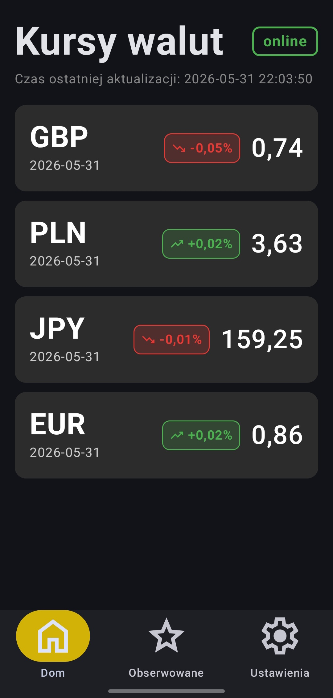
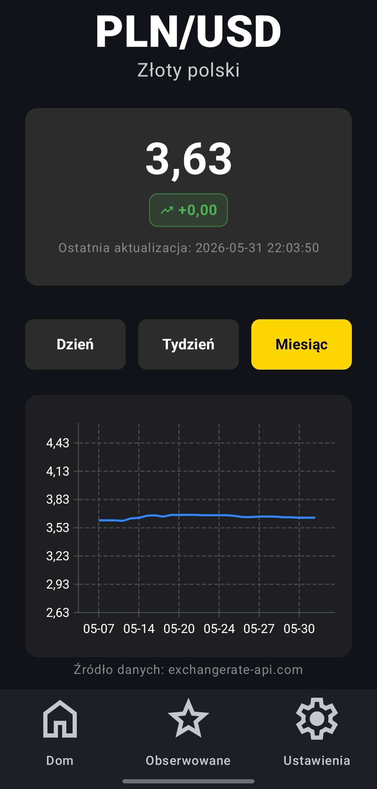
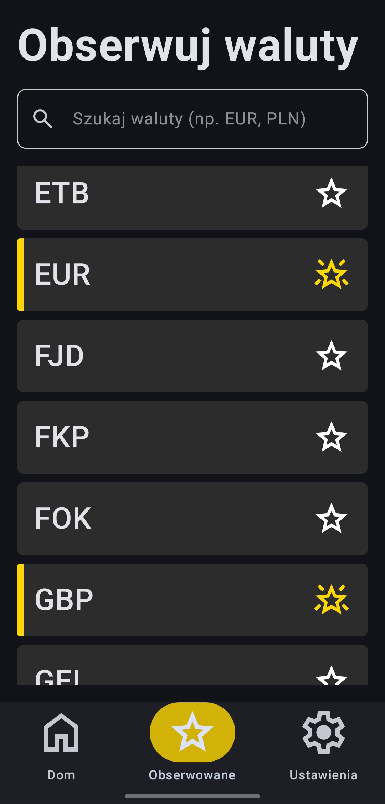
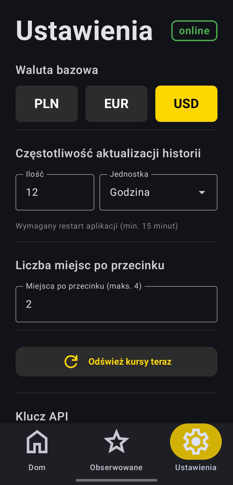
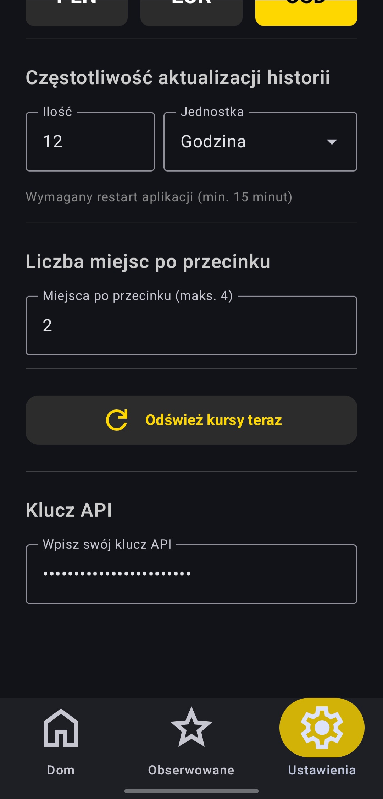

<div align="center">

# Currency Rate Tracker

**An Android app for tracking exchange rates, following currencies, and exploring historical trends.**


</div>

---

## Overview

Currency Rate Tracker is a native Android application built with Kotlin and Jetpack Compose. It retrieves exchange rates from [ExchangeRate-API](https://www.exchangerate-api.com/), keeps a local history for charting, and lets you follow selected currencies.

## Screenshots

<p align="center">
  <span style="display:inline-block; margin:10px; padding:8px 6px; border:4px solid #252525; border-radius:28px; background:#111;">
    <span style="display:block; width:44px; height:5px; margin:0 auto 8px; border-radius:5px; background:#555;"></span>
    
  </span>
  <span style="display:inline-block; margin:10px; padding:8px 6px; border:4px solid #252525; border-radius:28px; background:#111;">
    <span style="display:block; width:44px; height:5px; margin:0 auto 8px; border-radius:5px; background:#555;"></span>
    
  </span>
  <span style="display:inline-block; margin:10px; padding:8px 6px; border:4px solid #252525; border-radius:28px; background:#111;">
    <span style="display:block; width:44px; height:5px; margin:0 auto 8px; border-radius:5px; background:#555;"></span>
    
  </span>
</p>

<p align="center">
  <span style="display:inline-block; margin:10px; padding:8px 6px; border:4px solid #252525; border-radius:28px; background:#111;">
    <span style="display:block; width:44px; height:5px; margin:0 auto 8px; border-radius:5px; background:#555;"></span>
    
  </span>
  <span style="display:inline-block; margin:10px; padding:8px 6px; border:4px solid #252525; border-radius:28px; background:#111;">
    <span style="display:block; width:44px; height:5px; margin:0 auto 8px; border-radius:5px; background:#555;"></span>
    
  </span>
</p>

## Features

| Exchange rates and insights | Personalization and reliability |
| --- | --- |
| Current exchange rates with percentage trend indicators | Search and follow currencies in a personal watchlist |
| Historical charts with day, week, and month views | Choose PLN, USD, or EUR as the base currency |
| Pull-to-refresh and last-sync information | Configure automatic history updates and displayed decimal places |
| Online/offline connection status | Store rates locally for access between refreshes |
| Background history updates using WorkManager | Protect the API key with encrypted preferences |

## Tech Stack

- **Language:** Kotlin
- **UI:** Jetpack Compose, Material 3, adaptive navigation
- **Networking:** Retrofit and Gson
- **Charts:** Vico
- **Background tasks:** AndroidX WorkManager
- **Local storage:** App-internal files and SharedPreferences
- **API key storage:** AndroidX Security Crypto
- **Build system:** Gradle with Kotlin DSL and a version catalog

## Requirements

- Android Studio with support for Android Gradle Plugin 9.1.1
- JDK 17 or later
- Android SDK Platform 36.1
- An Android device or emulator running Android 11 (API 30) or later
- An API key from [ExchangeRate-API](https://www.exchangerate-api.com/)

## Getting Started

### 1. Open the project

Open the `Currency-tracker-app` directory in Android Studio and allow Gradle to sync.

### 2. Build and run

Run the `app` configuration from Android Studio, or build a debug APK from the project directory:

```powershell
.\gradlew.bat :app:assembleDebug
```

On macOS or Linux, use:

```bash
./gradlew :app:assembleDebug
```

### 3. Add your API key

Launch the app, open **Settings**, and enter your ExchangeRate-API key in the **API Key** field. The key is stored using AndroidX EncryptedSharedPreferences. Once configured, refresh rates from the home screen.

## Data and Updates

The app stores its data in its private internal storage; no database setup is required.

| File | Purpose |
| --- | --- |
| `latest_rates.txt` | Most recently fetched rates for the selected base currency |
| `historical_rates.txt` | Rate history used to calculate trends and populate charts |
| `followed.txt` | Currency codes in the watchlist |
| `sync_info.txt` | Timestamp of the last successful latest-rate update |

The update interval can be configured in **Settings**. WorkManager requires a minimum interval of 15 minutes, and changes to the schedule take effect after restarting the app. Background history collection currently fetches rates based on PLN, USD, and EUR.

## Project Structure

| Path | Purpose |
| --- | --- |
| `app/src/main/java/com/example/exchange_app/data/` | Settings, API-key security, models, and currency repository |
| `app/src/main/java/com/example/exchange_app/data/remote/` | ExchangeRate-API service and response models |
| `app/src/main/java/com/example/exchange_app/ui/screens/` | Home, favorites, details, and settings screens |
| `app/src/main/java/com/example/exchange_app/nav/` | App destinations and navigation |
| `app/src/main/java/com/example/exchange_app/worker/` | Scheduled background rate-history updates |
| `app/src/main/res/` | App icons, themes, colors, and other Android resources |
| `app/src/test/` | Local unit tests |
| `app/src/androidTest/` | Instrumented Android tests |
| `assets/` | README screenshots |
